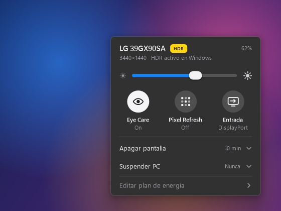
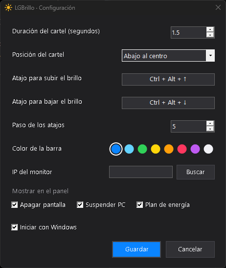
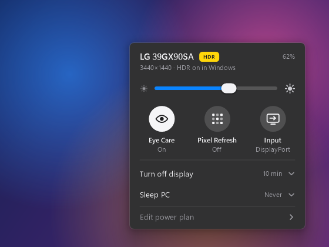
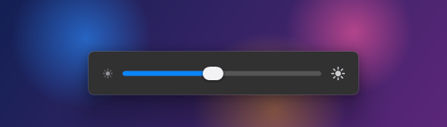
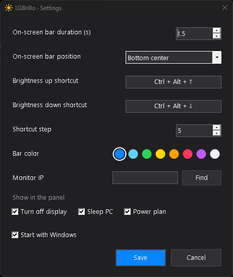

# LGBrillo

**Controlá el brillo de tu monitor o TV LG con webOS desde Windows, sin el control remoto.**
*Control the brightness of your LG webOS monitor or TV from Windows, no remote needed. [English below](#english).*



Los monitores LG con webOS (como la línea UltraGear OLED "Smart" o los MyView) no aceptan DDC/CI por DisplayPort o HDMI. Por eso programas como Twinkle Tray o Monitorian no pueden cambiarles el brillo, y lo único que queda es el control remoto. LGBrillo habla con el monitor **por la red (Wi‑Fi o cable)**, igual que la app oficial de LG para el celular.

## Qué hace

- **Brillo** con una barra en la bandeja de Windows, o con un atajo de teclado desde cualquier programa (por defecto **Ctrl+Alt+↑ / ↓**, y lo podés cambiar).
- **Cartel al usar los atajos**, que también se puede arrastrar con el mouse.
- **Eye Care** (luz azul reducida del monitor).
- **Pixel Refresh**: le pide al monitor OLED que limpie los píxeles la próxima vez que se apague.
- **Entrada de video**: cambia entre DisplayPort, HDMI, USB‑C, etc.
- **Aviso de HDR**: te muestra si Windows tiene el HDR activo (el brillo se guarda por separado en cada modo de imagen).
- **Inactividad de Windows**: elegí cuándo se apaga la pantalla y cuándo se suspende la PC ("Nunca" arriba de todo), con acceso directo a "Editar plan de energía".
- **Diseño nativo de Windows 11**: desenfoque Acrylic y Mica de verdad, y la fuente Segoe UI Variable. En Windows 10 el desenfoque se imita.
- **Configuración** (clic derecho en el ícono): atajos de teclado, duración y posición del cartel, paso de los atajos, color de la barra, qué filas mostrar en el panel, IP del monitor e iniciar con Windows.

| Cartel de los atajos | Configuración |
|---|---|
|  |  |

## Instalación

1. Descargá `LGBrillo.exe` de la última versión, en [Releases](../../releases). No necesita instalación: es un solo archivo de menos de 100 KB y usa el .NET Framework que ya trae Windows 10 y 11.
2. El monitor tiene que estar **prendido y en la misma red** que la PC.
3. Abrí `LGBrillo.exe`. La primera vez aparece un aviso en el monitor pidiendo permiso: **aceptalo con el control remoto** (es una sola vez).
4. Listo: el sol blanco de la bandeja abre el panel.

> Windows SmartScreen puede advertir que el programa "no es reconocido", porque no está firmado. Podés revisar el código y compilarlo vos mismo (ver abajo).

## Compatibilidad

LGBrillo usa el protocolo de control remoto de webOS (SSAP, puerto 3001), el mismo en todos los equipos LG con webOS. Funciones como Pixel Refresh dependen de que el equipo las tenga.

| Equipo | webOS | Estado |
|---|---|---|
| LG UltraGear OLED **39GX90SA** | webOS 24 | ✅ Probado: brillo, Eye Care, entradas, HDR |
| LG UltraGear OLED 45GX90SA | webOS | 🟡 Debería funcionar (sin probar) |
| LG UltraGear 32G810SA | webOS | 🟡 Debería funcionar (sin probar) |
| LG MyView 32SR85U / 32SR83U / 32SR70U | webOS | 🟡 Debería funcionar (sin probar) |
| LG MyView 34SR65QC / 34SR60QC | webOS | 🟡 Debería funcionar (sin probar) |
| LG MyView 27SR50F, 32U889SA | webOS | 🟡 Debería funcionar (sin probar) |
| Televisores LG OLED y LCD con webOS (2018 en adelante) | webOS 4+ | 🟡 Debería funcionar (sin probar) |

¿Lo probaste en otro modelo? Abrí un [issue](../../issues) contando el modelo, la versión de webOS y qué anduvo, y lo agrego a la tabla.

**Limitaciones conocidas**

- **Eye Care y Pixel Refresh no se pueden leer por la red, solo cambiar.** El panel recuerda lo último que elegiste ahí. Si los cambiás con el control remoto, el botón puede quedar al revés.
- **Brillo por modo de imagen:** cada modo (SDR, HDR, etc.) guarda su propio brillo, y LGBrillo cambia el del modo activo.
- **Parpadeo posible:** para cambiar ajustes, la app abre y cierra al instante un aviso invisible en el monitor, así que en algunos equipos se puede notar un parpadeo.

## Compilarlo vos mismo

No hace falta Visual Studio, alcanza con el compilador de C# que trae Windows:

```powershell
powershell -ExecutionPolicy Bypass -File build.ps1
```

Eso genera `LGBrillo.exe` a partir de `LGBrillo.cs`.

## Idioma

La app se muestra en español si Windows está en español, y en inglés en cualquier otro caso.

## Privacidad

La app no se conecta a internet: habla solo con el monitor en tu red local. La llave de emparejamiento y la configuración se guardan en `%APPDATA%\LGBrillo\config.json`.

## Créditos

- Creado por **Wade** · X: [@wade9_](https://x.com/wade9_)
- El protocolo de webOS y el manifiesto de emparejamiento se documentaron gracias a [bscpylgtv](https://github.com/chros73/bscpylgtv) y [aiopylgtv](https://github.com/bendavid/aiopylgtv).
- LG, webOS y UltraGear son marcas de LG Electronics. Este proyecto no está afiliado a LG.

Licencia [MIT](LICENSE). Es gratis: si te sirve, compartilo.

---

## English



LG monitors with webOS (UltraGear OLED "Smart" models, MyView) don't support DDC/CI over DisplayPort/HDMI, so tools like Twinkle Tray or Monitorian can't change their brightness. LGBrillo talks to the monitor **over your local network**, the same way LG's phone app does.

| Hotkey bar | Settings |
|---|---|
|  |  |

**Features:**
- **Brightness** from a tray slider or a keyboard shortcut (**Ctrl+Alt+↑/↓** by default, customizable), with an on-screen bar you can drag with the mouse.
- **Windows inactivity**: pick when the display turns off and when the PC sleeps ("Never" at the top), plus a shortcut to "Edit power plan".
- **Native Windows 11 look**: real Acrylic and Mica backdrops and the Segoe UI Variable font (blur is imitated on Windows 10).
- **Eye Care** (the monitor's low blue light mode).
- **Pixel Refresh** the next time the monitor is turned off (OLED models).
- **Video input** switching (DisplayPort, HDMI, USB-C).
- **HDR indicator**: shows when Windows HDR is active.
- **Settings** (right-click the tray icon): shortcuts, OSD duration and position, shortcut step, bar color, which rows the panel shows, monitor IP and start with Windows.

**Setup:** download `LGBrillo.exe` from [Releases](../../releases), make sure the monitor is on and on the same network, run it, and accept the pairing prompt on the monitor with the remote (only once). The app shows English, or Spanish when Windows is set to Spanish.

**Known limits:** Eye Care and Pixel Refresh can only be set over the network, not read, so the panel remembers your last choice. Each picture mode (SDR, HDR…) keeps its own brightness. Changing settings briefly opens an invisible alert on the monitor, which may flicker on some models.

**Privacy:** no internet access; it only talks to the monitor on your local network. Settings and the pairing key live in `%APPDATA%\LGBrillo\config.json`.

**Compatibility:** tested on the LG 39GX90SA (webOS 24). It should work on other LG webOS monitors and TVs, since they use the same SSAP protocol on port 3001. Reports are welcome in [issues](../../issues).

**Build it yourself:** `powershell -ExecutionPolicy Bypass -File build.ps1`. It only needs the C# compiler that ships with Windows.

Made by **Wade** · X: [@wade9_](https://x.com/wade9_) · MIT license · Not affiliated with LG Electronics.
