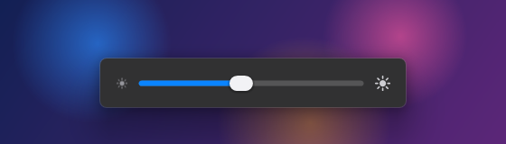
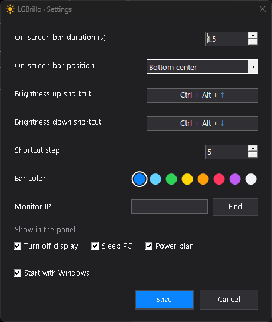

# LGBrillo

**Control the brightness of your LG webOS monitor or TV from Windows, no remote needed.**


LG monitors with webOS (such as the UltraGear OLED "Smart" line or the MyView series) don't accept DDC/CI over DisplayPort or HDMI. That's why tools like Twinkle Tray or Monitorian can't change their brightness, which leaves you with the remote. LGBrillo talks to the monitor **over your local network (Wi‑Fi or Ethernet)**, the same way LG's official phone app does.

## Features

- **Brightness** from a tray slider, or from any app with a keyboard shortcut (**Ctrl+Alt+↑ / ↓** by default, customizable).
- **On-screen bar** when you use the shortcuts. You can also drag it with the mouse.
- **Eye Care** (the monitor's low blue light mode).
- **Pixel Refresh**: asks the OLED monitor to clean its pixels the next time it turns off.
- **Video input** switching: DisplayPort, HDMI, USB‑C, etc.
- **HDR indicator**: shows when Windows HDR is on (each picture mode keeps its own brightness).
- **Windows inactivity**: choose when the display turns off and when the PC sleeps ("Never" at the top), plus a shortcut to "Edit power plan".
- **Native Windows 11 look**: real Acrylic and Mica backdrops and the Segoe UI Variable font. On Windows 10 the blur is imitated.
- **Settings** (right-click the tray icon): shortcuts, on-screen bar duration and position, shortcut step, bar color, which rows the panel shows, monitor IP and start with Windows.

| On-screen bar | Settings |
|---|---|
|  |  |

## Install

1. Download `LGBrillo.exe` from the latest [release](../../releases). There's nothing to install: it's a single file under 100 KB that uses the .NET Framework already included in Windows 10 and 11.
2. The monitor must be **on and on the same network** as the PC.
3. Run `LGBrillo.exe`. The first time, the monitor shows a prompt asking for permission: **accept it with the remote** (only once).
4. Done: the white sun in the tray opens the panel.

> Windows SmartScreen may warn that the app is "unrecognized" because it isn't signed. You can read the code and build it yourself (see below).

The app is shown in English, or in Spanish when Windows is set to Spanish.

## Compatibility

LGBrillo uses the webOS remote control protocol (SSAP, port 3001), which is the same on every LG webOS device. Features like Pixel Refresh depend on the device having them.

| Device | webOS | Status |
|---|---|---|
| LG UltraGear OLED **39GX90SA** | webOS 24 | ✅ Tested: brightness, Eye Care, inputs, HDR |
| LG UltraGear OLED 45GX90SA | webOS | 🟡 Should work (untested) |
| LG UltraGear 32G810SA | webOS | 🟡 Should work (untested) |
| LG MyView 32SR85U / 32SR83U / 32SR70U | webOS | 🟡 Should work (untested) |
| LG MyView 34SR65QC / 34SR60QC | webOS | 🟡 Should work (untested) |
| LG MyView 27SR50F, 32U889SA | webOS | 🟡 Should work (untested) |
| LG OLED and LCD TVs with webOS (2018 and later) | webOS 4+ | 🟡 Should work (untested) |

Tried it on another model? Open an [issue](../../issues) with the model, the webOS version and what worked, and I'll add it to the table.

**Known limits**

- **Eye Care and Pixel Refresh can only be set over the network, not read.** The panel remembers your last choice. If you change them with the remote, the button may show the opposite state.
- **Brightness per picture mode:** each mode (SDR, HDR, etc.) keeps its own brightness, and LGBrillo changes the one for the active mode.
- **Possible flicker:** to change settings, the app opens and instantly closes an invisible alert on the monitor, which may flicker on some models.

## Build it yourself

You don't need Visual Studio, only the C# compiler that ships with Windows:

```powershell
powershell -ExecutionPolicy Bypass -File build.ps1
```

This creates `LGBrillo.exe` from `LGBrillo.cs`.

## Privacy

The app never goes online: it only talks to the monitor on your local network. The pairing key and your settings are stored in `%APPDATA%\LGBrillo\config.json`.

## Credits

- Made by **Wade** · X: [@wade9_](https://x.com/wade9_)
- The webOS protocol and pairing manifest are documented thanks to [bscpylgtv](https://github.com/chros73/bscpylgtv) and [aiopylgtv](https://github.com/bendavid/aiopylgtv).
- LG, webOS and UltraGear are trademarks of LG Electronics. This project is not affiliated with LG.

[MIT](LICENSE) license. It's free: if it helps you, share it.
